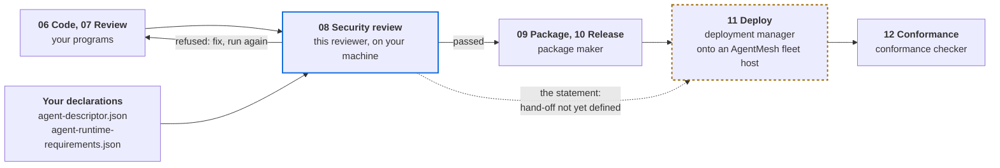
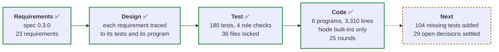
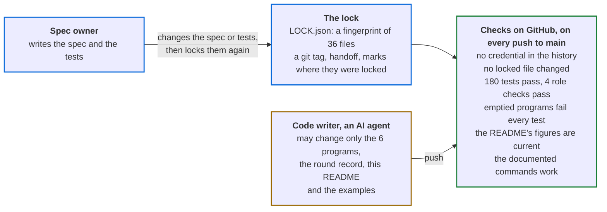
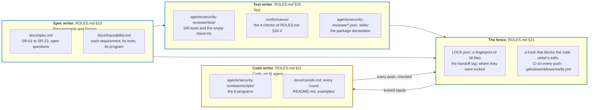

# adlc-security-reviewer

[](https://github.com/PaulDuvall/adlc-security-reviewer/actions/workflows/verify.yml)

A security gate for AI agents. Before anyone installs an agent, this reviewer reads the agent's
package. It checks what the code really reaches against what the package declares. Then it
gives one of three answers: **passed**, with a security statement; **refused**, with every
problem listed; or **declined**, when asked to do more than review.

It implements the security reviewer, one of the roles in the Agent Development Lifecycle (ADLC).
The role is defined in [ROLES.md §34](https://github.com/CommonAgent/common-agent-standards/blob/main/roles/ROLES.md#34-role-the-security-reviewer) of the Common Agent
Standards, summarized at [agentroles.ai/security-reviewer](https://agentroles.ai/security-reviewer.html),
and its stage is at [agenticdevelopment.ai](https://agenticdevelopment.ai/stages.html#security).

## Where it stands

Status on 29 October 2026: complete against spec 0.3.0. Its 23 requirements, 180 tests and 4
role checks all pass, on Node 22 and on Node 26. Open: 29 decisions the spec leaves open, 104
tests the suite lacks, and some URL forms the spec does not refuse
([What is still open](#what-is-still-open)).

| | Check | Result |
|---|---|---|
| ✅ | Automated checks on GitHub | Pass on the latest push to `main` |
| ✅ | Spec | Version 0.3.0, with 23 numbered requirements |
| ✅ | Tests | 180 of 180 pass. Each one traces to a requirement |
| ✅ | Role checks | 4 of 4 pass: the four scenarios [ROLES.md §34.4](https://github.com/CommonAgent/common-agent-standards/blob/main/roles/ROLES.md#344-conformance-testing-the-security-reviewer) requires, run by a check written here |
| ✅ | The tests catch broken code | With the 6 programs emptied, 0 of 180 tests pass. Deleting any one program makes 122 to 157 of the 180 tests fail |
| ✅ | The AI that wrote the code cannot change the tests unseen | A fingerprint covers 36 files, including the spec and the tests. A push that changes any of them turns the checks on GitHub red, unless it also rewrites the checks, which then shows in its diff |
| ✅ | Planted-bug check | The tests catch 91.8% of 3,557 small bugs planted in copies of the code, against the usual target of 80% ([Stryker's default](https://stryker-mutator.io/docs/stryker-js/configuration/#thresholds-object)). Last measured on round 13's code, with tools kept outside this repository |
| 🟡 | Open decisions | [11 questions the spec leaves open](docs/spec.md#open-questions), and [18 points where the spec is silent and the code made its own choice](docs/rounds.md#points-the-statement-does-not-settle) |

## What it does for users

It reads the agent's package and the owner's spending limit. It checks every system the code
really contacts against what the package declares. Then it gives one of three answers.


The passed answer is a real run on the suite's sample agent, `ticket-reader`, with a $5.00 daily
limit. The refused answer is the same agent with four faults added: a billing web address, a
billing key, an empty reason and no limit. The reviewer's output on `main` matches both.

| Who | What they get | Why it matters |
|---|---|---|
| The owner installing an agent | A statement of every system the agent reaches, with its access and reason, what it may spend, what it must never do, and the risks the owner accepts by installing it | What the code reaches is checked against the code. The reasons and the "never" list are the publisher's own words, shown as written |
| The agent's publisher | A refusal that lists every problem found, with the file and line where one applies | Fixes come in one batch, not one problem at a time |
| The platform or security team | The same answer for the same request on the same Node version, stamped with the package's fingerprint (its digest). The reviewer never grants anything itself | The answer can serve as the record of the install decision. Changing one byte of a shipped file changes the fingerprint |

One judgment stays with a person: whether each stated reason is good enough. The answer shows
every reason and lists this judgment as not checked.

## Use it on your agent

You have built an agent and want it on AgentMesh. Run this review before you package or
deploy it. It names, in one answer, everything this reviewer would refuse.

### Where it fits

The review is stage 08 of the [Agent Development Lifecycle](https://agenticdevelopment.ai/stages.html).
It comes after your code is written and reviewed, and before the agent is packaged and
deployed. An agent joins the mesh at Deploy, stage 11, so the review comes first: the limits
are set before any credential is placed.



The lifecycle does not settle three points yet.

| Gap | What to do for now |
|---|---|
| The [stages page](https://agenticdevelopment.ai/stages.html) lists the two declaration files as outputs of Package, stage 09. The reviewer reads them, so it cannot run without them | Write both files before the review. The package maker can start from them |
| [ROLES.md §34.3](https://github.com/CommonAgent/common-agent-standards/blob/main/roles/ROLES.md#34-role-the-security-reviewer) calls the statement the record, and names no one who reads it next | Keep the statement with the install decision, and give it to whoever deploys the agent |
| Running on a fleet host needs a host contract AgentMesh has not published ([spec](docs/spec.md#out-of-scope-for-030)) | Run it locally, as below |

### What you need

| Need | Detail |
|---|---|
| Node 22.13 or later, and a clone of this repo | No dependencies, no install step. Node 26 cannot transform TypeScript, so there a package with TypeScript that needs it, such as an `enum`, a `namespace` or a constructor parameter property, is refused `unreadable`: review it on Node 22.13 to 25 |
| Your agent's folder | `agent-descriptor.json`, `agent-runtime-requirements.json`, every file you ship, and optionally `plugin.json` for the name and version |
| The owner's spending limit | In millionths of the currency: `5000000` is $5.00 |
| The owner's number for each ceiling | Only where your runtime requirements list `ceilings` |

### Run it

Get the reviewer:

```bash
git clone https://github.com/PaulDuvall/adlc-security-reviewer.git
cd adlc-security-reviewer
```

Write the request to `request.json`:

```json
{
  "review": "v1",
  "ask": "review",
  "package": "/path/to/your-agent",
  "owner": {
    "spend_limit": { "most_micro": 5000000, "currency": "USD", "per": "day" },
    "ceilings": []
  }
}
```

`package` may be relative to the folder you run from. Each `ceilings` entry gives the owner's
`most` for one entry in your runtime requirements, matched on `system` and `per`.

From the root of this repo:

```bash
node --permission --allow-fs-read='*' agents/security-reviewer/scripts/review.mjs < request.json
```

The flags make Node itself refuse any file write or new process. The reviewer writes one line
of JSON and exits 0, whatever the answer.

To try it before writing your own request, run one of the sample agents in
[`examples/`](examples/). Each request's answer is recorded in `examples/answers/`, and the suite
checks that the reviewer still gives it:

```bash
node --permission --allow-fs-read='*' agents/security-reviewer/scripts/review.mjs < examples/requests/review-faults.json
```

### Read the answer

| Answer | What it means | Next |
|---|---|---|
| `passed` | A `statement`: each system reached, its access and reason, the limit, what it must never do, what was accepted knowingly, and what was not checked | Package and release it. Run the review again after any change: one changed byte changes the digest |
| `refused` | Every problem found, each with a `rule`, and the file and line where one applies | Fix them all, then run again |
| `declined` | The request asked for something other than a review | Ask for `review`. It never grants, binds or installs |

The answer to `examples/requests/review-faults.json`, in full. Its sample agent,
[`examples/ticket-reader-faults`](examples/ticket-reader-faults/), has the four faults the
diagram above shows: a hard-coded billing address, an undeclared billing key, a blank reason
and no spending limit. It adds them as a second function, so they sit on lines 11 and 12.

```json
{
  "result": "refused",
  "package": { "name": "ticket-reader", "version": "0.1.0", "digest": "sha256:cc4831d4…" },
  "refusals": [
    { "rule": "no-reason", "system": "ticket-store",
      "why": "the descriptor records no reason (needs) for reaching ticket-store" },
    { "rule": "undeclared-reach", "system": "api.billing.example.com",
      "file": "skills/read-tickets/scripts/read.mjs", "line": 11,
      "why": "the program reaches api.billing.example.com by a URL in its code, not through a system the host binds" },
    { "rule": "undeclared-reach", "system": "BILLING_API_KEY",
      "file": "skills/read-tickets/scripts/read.mjs", "line": 12,
      "why": "the program reads the credential-like variable BILLING_API_KEY, which the runtime requirements do not bind" },
    { "rule": "spend-limit", "why": "the owner set no spending limit" }
  ]
}
```

### Fix the usual first refusal

Most agents are refused first for a web address written in their code. Declaring the system
is not enough: the address must come from a setting the host binds.

```js
// Refused: the host is in the code
fetch("https://api.billing.example.com/charge", { headers: { authorization: process.env.BILLING_API_KEY } });

// Passes: the host and the key both come from what the runtime requirements bind
fetch(`${process.env.BILLING_URL}/charge`, { headers: { authorization: process.env.BILLING_API_KEY } });
```

Then declare the system in both files. In `agent-descriptor.json`:

```json
{ "name": "billing", "access": "write", "needs": "to charge for each summary" }
```

In `agent-runtime-requirements.json`:

```json
{
  "name": "billing", "kind": "service", "credential": "billing-key", "env": "BILLING_API_KEY",
  "settings": [{ "env": "BILLING_URL", "purpose": "where billing answers" }]
}
```

The review then passes, and lists `billing` under `accepted_knowingly`, since its access is
`write`. [`examples/`](examples/) holds both versions: `ticket-reader-billing-hardcoded`
and `ticket-reader-billing`. A web address in a comment does not count. One in a string
does, even one used only as a name, such as a JSON Schema address
([open question 5](docs/spec.md#open-questions)).

### Every refusal rule

| Rule | Cause | Usual fix |
|---|---|---|
| `bad-request` | The request is not valid JSON, lacks `"review": "v1"`, or names no package | Match the request above |
| `unreadable` | The folder is missing, a declaration file is not a JSON object, an `mcp.json` cannot be read, a shipped file is a link to a file outside the package, or, on Node 26, a TypeScript program needs transforming | Fix what it names. Ship the file a link points to in place of the link |
| `systems-mismatch` | The two declaration files name different systems | Name each system in both |
| `no-reason` | A system has a missing or blank `needs` | Say why the agent needs it |
| `undeclared-reach` | A program contains a web address or reads an unbound credential-like variable, or an MCP server is not a declared system | Declare the system, bind its credential and address, and read both from the environment |
| `spend-limit` | The owner's limit is missing or malformed | Set `owner.spend_limit` |
| `ceiling-missing` | A system that spends has no ceiling, or says the wrong side enforces it | Add a ceiling. A system with a credential needs `enforced_by: runtime` |
| `ceiling-unset` | The owner gave no number for a ceiling | Add it under `owner.ceilings` |
| `credential-in-files` | A shipped file holds a credential | Remove it and rotate it. The answer names the file and kind, never the value |
| `dependency-unpinned` | A lockfile is missing, differs from its `sha256`, or leaves a package without `integrity` | Ship the lockfile and record its `sha256` |
| `unread-code` | A program loads code the review does not read | Load only shipped files, dependencies and built-ins |

### What a pass does not cover

A pass is not a full audit. `not_checked` lists what was not checked, including known
vulnerabilities in dependencies and addresses built at runtime. A person still decides whether
each reason is good enough. The digest covers your package folder, not the release archive,
so it will not match the digest Release records ([open question 7](docs/spec.md#open-questions)).

#### Known gaps

A pass means the package has none of the faults the reviewer looks for. It is not yet proof
against a publisher who sets out to get past it. These pass today:

| Gap | What gets past | Where it is tracked |
|---|---|---|
| Other ways to load code | `require.call`, `require.apply`, `Reflect.apply`, an alias of `require`, `new Worker(…)`, `__import__`, `runpy` or a `.pth` file can load a file the reviewer never read. `not_checked` does not name them | [Open question 8](docs/spec.md#open-questions) |
| What a tool server runs | A declared MCP server's `command` may run an unshipped file, and its `url` may name any host | [Open question 9](docs/spec.md#open-questions) |
| Links to folders | Files reached only through a symbolic link to a folder are not read | [Open question 10](docs/spec.md#open-questions) |
| Old npm lockfiles | A version-1 `package-lock.json` has no entries the pin check reads, so an unpinned one passes without a mention | [Open question 11](docs/spec.md#open-questions) |
| An alias of the environment | `const e = process.env; e.BILLING_API_KEY` is not seen as a read | [U10](docs/rounds.md#points-the-statement-does-not-settle) |
| A relative module name with a package | `importlib.import_module(".helpers", "tests")` loads `tests.helpers`, but the name as written has no `tests` part | [U23](docs/rounds.md#points-the-statement-does-not-settle) |
| Unusual URL forms | `fetch("https:// x@evil.example/")` and `` fetch("https://«`.evil.example/") `` pass, though Node sends each to a host under evil.example | [Rounds 19 and 20](docs/rounds.md#rounds), U8 |
| Addresses built at runtime | A host or module path computed by the code, such as `` `https://${host}/` ``, is not refused. `not_checked` says such destinations were not checked | [U8](docs/rounds.md#points-the-statement-does-not-settle) |
| Credentials of other kinds | Shipped files are searched for 7 patterns: private keys, PKCS#12 keystores, service-account keys, AWS keys and NKey seeds. Any other secret string passes | SR-13 |

Report a way past the reviewer privately, as [SECURITY.md](SECURITY.md) says. These gaps are
already known.

## What has been done

This repo was built in the ADLC's four build stages: requirements, design, tests and code. All
four are done.



The Code stage ran in 25 rounds. Round 1 wrote the code. The rounds after it attacked the code
and fixed what broke: reviews with a skeptic re-checking each finding, bugs planted to test the
tests, and comparisons with CPython, V8 and Node on generated programs. [docs/rounds.md](docs/rounds.md)
records each round: what was tried, what failed and what changed.

## How the tests stay honest

The code writer is an AI agent. A hook blocks its editing tools on the spec, the tests and
every other locked file, and its settings deny the usual commands that re-lock them or move the
`handoff` tag. A push that changes a locked file turns the checks on GitHub red. GitHub does
not refuse the push itself: the red checks and the diff show it.



Only the spec owner changes the spec or the tests, each time in its own "Re-lock" commit. No
one can move the `handoff` tag while its ruleset is on, so a re-lock needs a repository admin
to turn the ruleset off, move the tag, and turn it back on.

## What is still open

| Item | Owner | Where |
|---|---|---|
| 104 tests the suite lacks: 70 gaps, and 34 cases from bugs already fixed | Spec owner, at the next reopen | [docs/rounds.md](docs/rounds.md#test-ideas-from-round-17) |
| The protections on GitHub. `main` cannot be deleted or force-pushed, and the `handoff` tag cannot be moved or deleted, by anyone, while their rulesets are on. No ruleset asks for a review or a green check before a push to `main`; the spec owner is the only person with write access | Spec owner: add the review ruleset in `tools/handoff.sh` if anyone else gets write access | `tools/handoff.sh` |
| 11 small changes to locked files: a second way to report a vulnerability, the CI step that decides which stage a commit is in, version and runtime fields, credit notices in the spec, and others | Spec owner, at the next reopen | [docs/rounds.md](docs/rounds.md#for-the-spec-owner-from-round-23) |
| 11 questions the spec leaves open, such as other ways code can load code, what an agent's tool servers run, and old npm lockfiles | Spec owner: 7. Need input from AgentMesh: 4 | [docs/spec.md](docs/spec.md#open-questions) |
| 18 points where the spec is still silent and the code made its own choice | Spec owner may settle any | [docs/rounds.md](docs/rounds.md#points-the-statement-does-not-settle) |
| URL forms that pass, though Node's URL parser sends them to a host: some because SR-08 reads them so, such as `https:// x@evil.example/`, and some by the code's own rule that a host it finds past a bracket or quotation mark holds a letter or a digit, such as `` https://«`.evil.example/ `` | Spec owner | [docs/rounds.md](docs/rounds.md#rounds), rounds 19 and 20 |
| On a developer's own machine, the lock check skips files that local git settings hide: `.git/info/exclude`, global excludes or an untracked `.gitignore`. The checks on GitHub are unaffected | Spec owner; accepted as a known limit | [docs/rounds.md](docs/rounds.md), round 10 |

## How this repository is built

Each piece was made by one role of the [ADLC](https://github.com/CommonAgent/common-agent-standards/blob/main/roles/ROLES.md),
and a fence keeps the code writer out of the pieces that judge its work. The spec owner held the
spec writer and test writer roles.



| Path | What it is | Who changes it |
|---|---|---|
| `docs/spec.md` | The job, as 23 requirements | Spec owner |
| `docs/traceability.md` | Each requirement, its tests and its program | Spec owner |
| `agents/security-reviewer/test/`, `conformance/` | The tests and the role checks | Spec owner |
| `CLAUDE.md`, `.claude/` | The code writer's instructions, and the hook that stops it editing locked files. They configure the AI agent that writes the code; a person using the reviewer needs neither | Spec owner |
| Everything else: `tools/`, `.github/`, `LOCK.json`, `LICENSE`, `NOTICE`, `SECURITY.md` | The lock, the checks, the license and the security policy | Spec owner |
| `agents/security-reviewer/scripts/` | The six programs | Code writer |
| `docs/rounds.md`, `README.md` | The record of each round, and this page | Code writer |
| `examples/` | Sample agents, the requests [Use it on your agent](#use-it-on-your-agent) runs, and the answer recorded for each | Code writer; the suite checks each answer |

Run every check:

```bash
npm run verify
```

| Command | What it does |
|---|---|
| `npm test` | Checks no locked file changed, then runs the 180 tests |
| `npm run conformance` | Runs the 4 role checks |
| `npm run removal` | Checks the tests fail when the 6 programs are emptied, and when any one is deleted |
| `npm run readme` | Checks the README's figures against the repository: spec version, tests, rounds, program lines, locked files |
| `npm run docs` | Runs the reviewer commands in this README and `examples/README.md` as written, and checks their answers |
| `npm run verify` | Runs all five |

Node 22.13 or later and git. No dependencies. CI runs Node 22; round 23 ran every check on
Node 26 too.

## Contributing

Open an issue to report a bug or suggest a change. The checks on GitHub fail on a pull request
that changes anything outside the Code stage's paths: the six programs, `docs/rounds.md`, this
README and `examples/`. Changes to the spec, the tests or the checks are the spec owner's, so
propose those in an issue. Report a way past the reviewer privately, as
[SECURITY.md](SECURITY.md) says, not in an issue.

The repository is maintained by [@PaulDuvall](https://github.com/PaulDuvall). Most commits are
by Claude, the AI agent that writes the code under the rules above.

## License

MIT: see [LICENSE](LICENSE). Two parts come from other works and keep their own terms. The
credential patterns in `secrets.mjs` are copied from [CommonAgent/adlc](https://github.com/CommonAgent/adlc)
under Apache-2.0, and `docs/spec.md` and the comments of `conformance/security-reviewer-check.mjs`
adapt passages of the [Common Agent Standards](https://github.com/CommonAgent/common-agent-standards)
under CC BY 4.0. [NOTICE](NOTICE) has the details.
