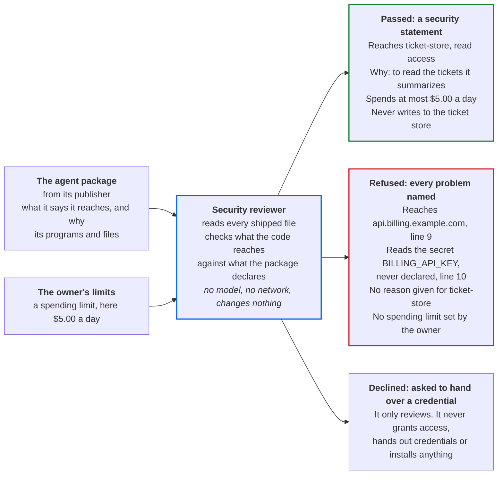
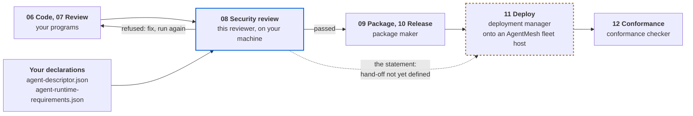
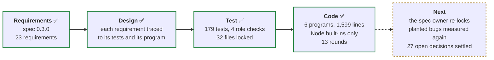
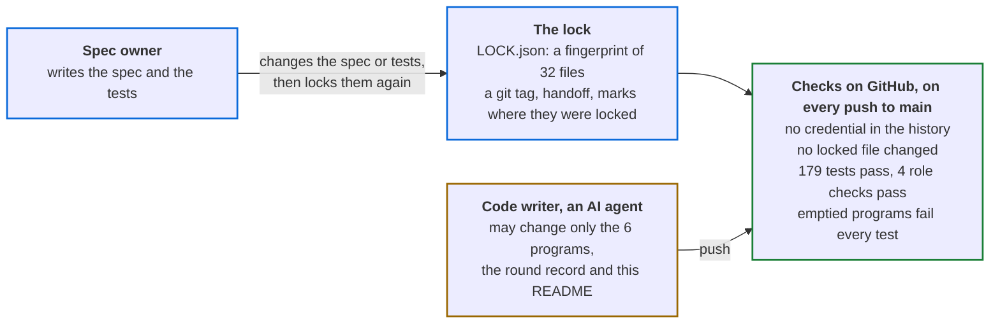

# adlc-security-reviewer

[](https://github.com/RedactedVentures/adlc-security-reviewer/actions/workflows/verify.yml)

A security gate for AI agents. Before anyone installs an agent, this reviewer reads the agent's
package. It checks what the code really reaches against what the package declares. Then it
gives one of three answers: **passed**, with a security statement; **refused**, with every
problem listed; or **declined**, when asked to do more than review.

It implements the security reviewer, one of the roles in the Agent Development Lifecycle (ADLC).
The role is defined in [ROLES.md §34](https://github.com/CommonAgent/common-agent-standards/blob/main/roles/ROLES.md#34-role-the-security-reviewer) of the Common Agent
Standards, summarized at [agentroles.ai/security-reviewer](https://agentroles.ai/security-reviewer.html),
and its stage is at [agenticdevelopment.ai](https://agenticdevelopment.ai/stages.html#security).

## Where it stands

Status on 27 October 2026. Spec 0.3.0 and 92 new tests have landed, and all 179 tests pass. The
checks on GitHub fail until the spec owner re-locks the changed files. Two things are open: the
planted-bug check, being measured again, and 27 decisions the spec leaves open.

| | Check | Result |
|---|---|---|
| 🟡 | Automated checks on GitHub | Fail until the spec owner re-locks spec 0.3.0 and its tests. They last passed on `380f67b` |
| ✅ | Spec | Version 0.3.0, with 23 numbered requirements |
| ✅ | Tests | 179 of 179 pass. Each one traces to a requirement |
| ✅ | Role checks | 4 of 4 pass. These are the four scenarios [ROLES.md §34.4](https://github.com/CommonAgent/common-agent-standards/blob/main/roles/ROLES.md#344-conformance-testing-the-security-reviewer) requires. The check is local: no official one is published yet |
| ✅ | The tests catch broken code | With the 6 programs emptied, 0 of 179 tests pass. Deleting any one program makes 121 to 156 of the 179 tests fail |
| ✅ | The AI that wrote the code cannot change the tests unseen | A fingerprint covers 32 files, including the spec and the tests. Changing any of them fails the checks on GitHub |
| 🟡 | Planted-bug check | Before this reopen, 3,304 small bugs were planted in copies of the code, and the tests caught 2,226 of them, or 67.4%. The usual target is 80% ([Stryker's default](https://stryker-mutator.io/docs/stryker-js/configuration/#thresholds-object)). Round 9's 58 test ideas are now 84 tests, and a review of them added 8 more; the check is being measured again |
| 🟡 | Open decisions | [11 questions the spec leaves open](docs/spec.md#open-questions), and [16 points where the spec is still silent and the code made its own choice](docs/rounds.md#points-the-statement-does-not-settle). Spec 0.3.0 settled 5 of 21 |

## What it does for users

It reads the agent's package and the owner's spending limit. It checks every system the code
really contacts against what the package declares. Then it gives one of three answers.



The passed answer is a real run on the suite's sample agent, `ticket-reader`, with a $5.00 daily
limit. The refused answer is the same agent with four faults added: a billing web address, a
billing key, an empty reason and no limit. The reviewer's output on `main` matches both.

| Who | What they get | Why it matters |
|---|---|---|
| The owner installing an agent | A statement of every system the agent reaches, with its access and reason, what it may spend, what it must never do, and the risks the owner accepts by installing it | What the code reaches is checked against the code. The reasons and the "never" list are the publisher's own words, shown as written |
| The agent's publisher | A refusal that lists every problem found, with the file and line where one applies | Fixes come in one batch, not one problem at a time |
| The platform or security team | The same answer for the same request every time, stamped with the package's fingerprint (its digest). The reviewer never grants anything itself | The answer can serve as the record of the install decision. Changing one byte of a shipped file changes the fingerprint |

One judgment stays with a person: whether each stated reason is good enough. The answer shows
every reason and lists this judgment as not checked.

## Use it on your agent

You have built an agent and want it on AgentMesh. Run this review before you package or
deploy it. It names, in one answer, everything that would stop an owner installing it.

### Where it fits

The review is stage 08 of the [Agentic Development Lifecycle](https://agenticdevelopment.ai/stages.html).
It comes after your code is written and reviewed, and before the agent is packaged and
deployed. An agent joins the mesh at Deploy, stage 11, so the review comes first: the limits
are set before any credential is placed.



The lifecycle does not settle three points yet.

| Gap | What to do for now |
|---|---|
| The [stages page](https://agenticdevelopment.ai/stages.html) lists the two declaration files as outputs of Package, stage 09. The reviewer reads them, so it cannot run without them | Write both files before the review. The package maker can start from them |
| [ROLES.md §34.3](https://github.com/CommonAgent/common-agent-standards/blob/main/roles/ROLES.md#34-role-the-security-reviewer) calls the statement the record, and names no one who reads it next | Keep the statement with the install decision, and give it to whoever deploys the agent |
| Running on a fleet host needs a host contract AgentMesh has not published ([spec](docs/spec.md#out-of-scope-for-030)) | Run it locally, as below |

### What you need

| Need | Detail |
|---|---|
| Node 22.13 or later, and a clone of this repo | No dependencies, no install step |
| Your agent's folder | `agent-descriptor.json`, `agent-runtime-requirements.json`, every file you ship, and optionally `plugin.json` for the name and version |
| The owner's spending limit | In millionths of the currency: `5000000` is $5.00 |
| The owner's number for each ceiling | Only where your runtime requirements list `ceilings` |

### Run it

Write the request to `request.json`:

```json
{
  "review": "v1",
  "ask": "review",
  "package": "/path/to/your-agent",
  "owner": {
    "spend_limit": { "most_micro": 5000000, "currency": "USD", "per": "day" },
    "ceilings": []
  }
}
```

`package` may be relative to the folder you run from. Each `ceilings` entry gives the owner's
`most` for one entry in your runtime requirements, matched on `system` and `per`.

From the root of this repo:

```bash
node --permission --allow-fs-read='*' agents/security-reviewer/scripts/review.mjs < request.json
```

The flags make Node itself refuse any file write or new process. The reviewer writes one line
of JSON and exits 0, whatever the answer.

To try it before writing your own request, run one of the sample agents in
[`examples/`](examples/):

```bash
node --permission --allow-fs-read='*' agents/security-reviewer/scripts/review.mjs < examples/requests/review-faults.json
```

### Read the answer

| Answer | What it means | Next |
|---|---|---|
| `passed` | A `statement`: each system reached, its access and reason, the limit, what it must never do, what was accepted knowingly, and what was not checked | Package and release it. Run the review again after any change: one changed byte changes the digest |
| `refused` | Every problem found, each with a `rule`, and the file and line where one applies | Fix them all, then run again |
| `declined` | The request asked for something other than a review | Ask for `review`. It never grants, binds or installs |

The answer to `examples/requests/review-faults.json`, in full. Its sample agent,
[`examples/ticket-reader-faults`](examples/ticket-reader-faults/), has the four faults the
diagram above shows: a hard-coded billing address, an undeclared billing key, a blank reason
and no spending limit. It adds them as a second function, so they sit on lines 11 and 12.

```json
{
  "result": "refused",
  "package": { "name": "ticket-reader", "version": "0.1.0", "digest": "sha256:cc4831d4…" },
  "refusals": [
    { "rule": "no-reason", "system": "ticket-store",
      "why": "the descriptor records no reason (needs) for reaching ticket-store" },
    { "rule": "undeclared-reach", "system": "api.billing.example.com",
      "file": "skills/read-tickets/scripts/read.mjs", "line": 11,
      "why": "the program reaches api.billing.example.com by a URL in its code, not through a system the host binds" },
    { "rule": "undeclared-reach", "system": "BILLING_API_KEY",
      "file": "skills/read-tickets/scripts/read.mjs", "line": 12,
      "why": "the program reads the credential-like variable BILLING_API_KEY, which the runtime requirements do not bind" },
    { "rule": "spend-limit", "why": "the owner set no spending limit" }
  ]
}
```

### Fix the usual first refusal

Most agents are refused first for a web address written in their code. Declaring the system
is not enough: the address must come from a setting the host binds.

```js
// Refused: the host is in the code
fetch("https://api.billing.example.com/charge", { headers: { authorization: process.env.BILLING_API_KEY } });

// Passes: the host and the key both come from what the runtime requirements bind
fetch(`${process.env.BILLING_URL}/charge`, { headers: { authorization: process.env.BILLING_API_KEY } });
```

Then declare the system in both files. In `agent-descriptor.json`:

```json
{ "name": "billing", "access": "write", "needs": "to charge for each summary" }
```

In `agent-runtime-requirements.json`:

```json
{
  "name": "billing", "kind": "service", "credential": "billing-key", "env": "BILLING_API_KEY",
  "settings": [{ "env": "BILLING_URL", "purpose": "where billing answers" }]
}
```

The review then passes, and lists `billing` under `accepted_knowingly`, since its access is
`write`. [`examples/`](examples/) holds both versions: `ticket-reader-billing-hardcoded`
and `ticket-reader-billing`. A web address in a comment does not count. One in a string
does, even one used only as a name, such as a JSON Schema address
([open question 5](docs/spec.md#open-questions)).

### Every refusal rule

| Rule | Cause | Usual fix |
|---|---|---|
| `bad-request` | The request is not valid JSON, lacks `"review": "v1"`, or names no package | Match the request above |
| `unreadable` | The folder is missing, a declaration file is not a JSON object, or an `mcp.json` cannot be read | Fix the file it names |
| `systems-mismatch` | The two declaration files name different systems | Name each system in both |
| `no-reason` | A system has a missing or blank `needs` | Say why the agent needs it |
| `undeclared-reach` | A program contains a web address or reads an unbound credential-like variable, or an MCP server is not a declared system | Declare the system, bind its credential and address, and read both from the environment |
| `spend-limit` | The owner's limit is missing or malformed | Set `owner.spend_limit` |
| `ceiling-missing` | A system that spends has no ceiling, or says the wrong side enforces it | Add a ceiling. A system with a credential needs `enforced_by: runtime` |
| `ceiling-unset` | The owner gave no number for a ceiling | Add it under `owner.ceilings` |
| `credential-in-files` | A shipped file holds a credential | Remove it and rotate it. The answer names the file and kind, never the value |
| `dependency-unpinned` | A lockfile is missing, differs from its `sha256`, or leaves a package without `integrity` | Ship the lockfile and record its `sha256` |
| `unread-code` | A program loads code the review does not read | Load only shipped files, dependencies and built-ins |

### What a pass does not cover

A pass is not a full audit. `not_checked` lists what was not checked, including known
vulnerabilities in dependencies and addresses built at runtime. A person still decides whether
each reason is good enough. The digest covers your package folder, not the release archive,
so it will not match the digest Release records ([open question 7](docs/spec.md#open-questions)).

## What has been done

This repo was built in the ADLC's four build stages: requirements, design, tests and code. All
four are done.



The Code stage ran in thirteen rounds. Round 1 wrote the code, and round 5 built spec 0.2.0. The
other rounds attacked the code and fixed what broke, except round 10, which fixed the file lock.
[docs/rounds.md](docs/rounds.md) has the full record.

| Round | What was tried | What it found |
|---|---|---|
| 1 | Write the six programs | All 58 tests of the first spec pass |
| 2 | 36 extra checks on generated inputs | 6 bugs the tests missed, all fixed |
| 3 | Plant 1,578 bugs and see which the tests catch | The tests caught 64%. 4 more real bugs, all fixed |
| 4 | One targeted attack from the spec review | 1 bug, fixed: the reviewer skipped code placed after a rare line-break character |
| 5 | Spec 0.2.0 adds two rules: refuse code that loads files the reviewer does not read, and refuse undeclared tool servers. Other rules got stricter | Both built. 72 of 72 tests pass |
| 6 | Two independent reviews | About 20 ways an agent could load code the reviewer never checked, all fixed |
| 7 | Four review passes attack the code, and a skeptic re-checks each finding | 14 bugs confirmed and fixed. Python is now read by a tokenizer, not by pattern matching |
| 8 | A second attack review; 92,000 generated Python programs; a compile check on 6,771 JavaScript programs; 3,304 planted bugs | 7 bugs confirmed and fixed. Python: 0 differences from Python's own reader. JavaScript: no code hidden in 6,771 programs. The tests caught 67.4% of the planted bugs |
| 9 | Sort the 1,078 planted bugs the tests missed | 16 real bugs, all fixed. Two let an agent past the gate by writing a secret's name or a web address in escape codes |
| 10 | Make the file lock use git's list of files | Locking now works in any copy of the repo. A review found 7 issues in the change, all fixed. No program changed |
| 11 | Check the 58 test ideas against current code, then compare every legacy escape with Node | 1 bug, fixed: `require("./test\5710.js")` let an agent load an unread file past the gate. All 4,686 legacy escapes now decode as Node decodes them |
| 12 | Spec 0.3.0 and 84 new tests from the spec owner's reopen | 3 new tests failed until fixed: a specifier with an escape that cannot be decoded is refused, `process['env']` reads count, and an encoding declaration's line counts `\n` only. All 171 tests pass |
| 13 | An adversarial review of the reopen, then a comparison with Node of 1,716 environment-read forms | 6 gaps, all fixed: a 4,000-point program ran the reviewer out of memory; a long run of space took it quadratic time; `.mts`, `.cts` and `.pyw` programs went unread; an escape in `process` or `env` hid a read; overlapping credentials leaked a fragment; a `%5C` import was refused. 8 new tests; all 179 pass |

## How the tests stay honest

The code writer is an AI agent. A hook stops it from editing the spec or the tests, and the
checks on GitHub fail on any push that changes them.



Only the spec owner can change the spec or the tests. Each change shows in git as its own
"Re-lock" commit.

## What is still open

| Item | Owner | Where |
|---|---|---|
| Measure the planted-bug check again, now that round 9's ideas are 84 tests | Code writer, after the re-lock | [docs/rounds.md](docs/rounds.md), round 12 |
| 11 questions the spec leaves open, such as other ways code can load code, what an agent's tool servers run, and old npm lockfiles | Spec owner: 7. AgentMesh team: 4 | [docs/spec.md](docs/spec.md#open-questions) |
| 16 points where the spec is still silent and the code made its own choice | Spec owner may settle any | [docs/rounds.md](docs/rounds.md#points-the-statement-does-not-settle) |
| On a developer's own machine, the lock check skips files that local git settings hide: `.git/info/exclude`, global excludes or an untracked `.gitignore`. The checks on GitHub are unaffected | Spec owner; accepted as a known limit | [docs/rounds.md](docs/rounds.md), round 10 |

## How this repository is built

| Path | What it is | Who changes it |
|---|---|---|
| `docs/spec.md` | The job, as 23 requirements | Spec owner |
| `docs/traceability.md` | Each requirement, its tests and its program | Spec owner |
| `agents/security-reviewer/test/`, `conformance/` | The tests and the role checks | Spec owner |
| `examples/` | Sample agents, and the requests [Use it on your agent](#use-it-on-your-agent) runs | Spec owner |
| Everything else: `tools/`, `.github/`, `LOCK.json`, `CLAUDE.md` | The lock, the checks and the code writer's instructions | Spec owner |
| `agents/security-reviewer/scripts/` | The six programs | Code writer |
| `docs/rounds.md`, `README.md` | The record of each round, and this page | Code writer |

Run every check:

```bash
npm run verify
```

| Command | What it does |
|---|---|
| `npm test` | Checks no locked file changed, then runs the 179 tests |
| `npm run conformance` | Runs the 4 role checks |
| `npm run removal` | Checks the tests fail when the 6 programs are emptied, and when any one is deleted |
| `npm run verify` | Runs all three |

Node 22.13 or later and git. No dependencies.
