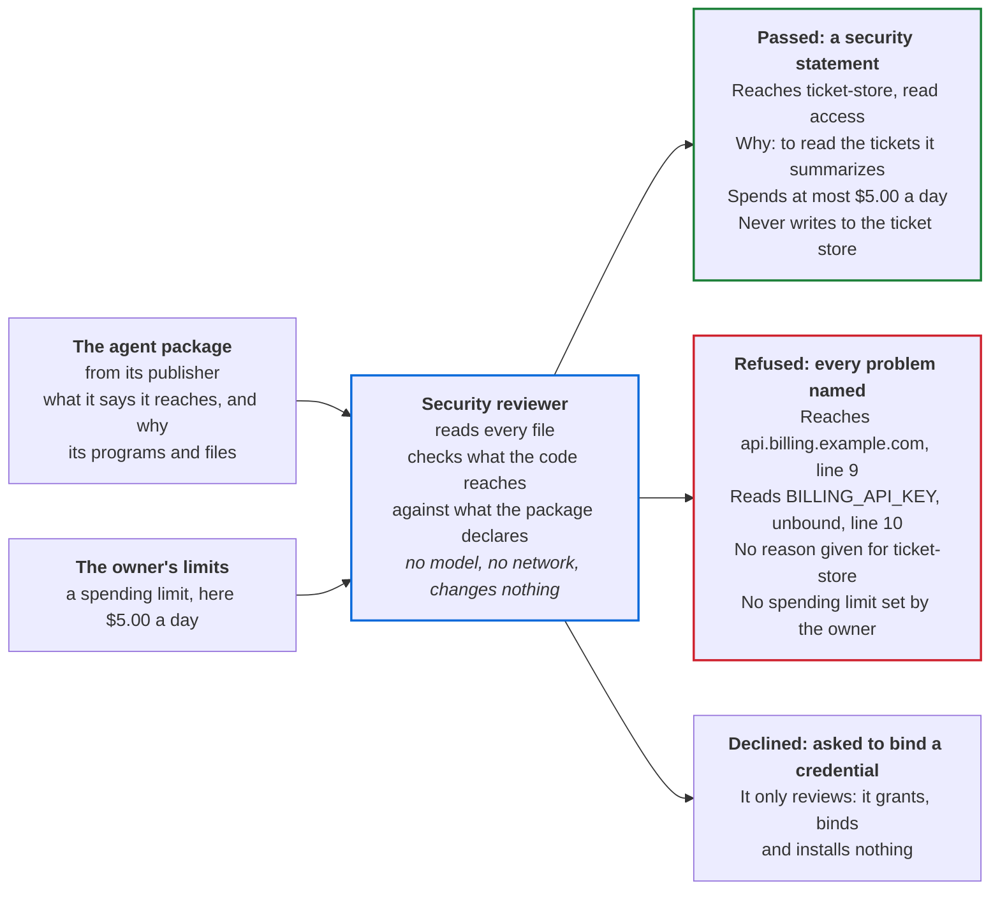
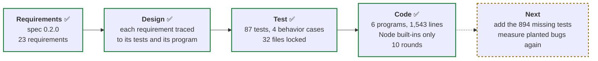
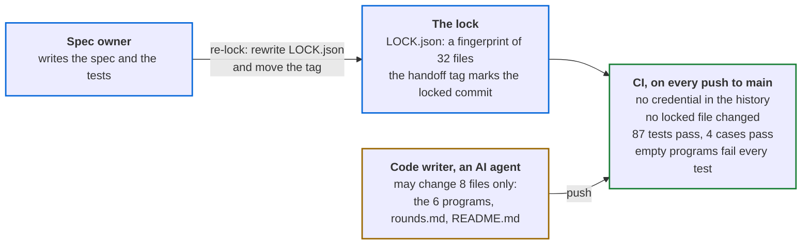

# adlc-security-reviewer

[](https://github.com/RedactedVentures/adlc-security-reviewer/actions/workflows/verify.yml)

A security gate for AI agents. Before anyone installs an agent, this reviewer reads the agent's
package and answers **passed**, **refused** or **declined**, with every reason checked against
the code.

It is the reference implementation of the ADLC **security reviewer** role
([agentroles.ai/security-reviewer](https://agentroles.ai/security-reviewer.html), ROLES.md §34),
the Security review stage at [agenticdevelopment.ai](https://agenticdevelopment.ai/stages.html#security).

## Where it stands

Status on 27 October 2026, at the `handoff` tag (`f957bf2`):

| | Check | Result |
|---|---|---|
| ✅ | CI on `main` | Green on the re-lock commit and on the `handoff` tag |
| ✅ | Spec | Version 0.2.0: 23 requirements, SR-01 to SR-23 |
| ✅ | Tests | 87 of 87 pass. Each one traces to a requirement |
| ✅ | Behavior cases | 4 of 4 of the role's conformance cases pass |
| ✅ | The tests catch broken code | Empty placeholder programs pass 0 of 87 tests. Removing any one program fails 64 to 72 |
| ✅ | The tests cannot be edited to pass | 32 files are locked. Any change to them turns CI red |
| 🟡 | How many planted bugs the tests catch | 67.4% of 3,304, measured on round 8. Stryker's default "high" mark is 80%. The 894 missing tests are listed for the next reopen |
| 🟡 | Open decisions | 10 open questions in the spec, and 21 choices the spec leaves to the code (U1 to U21) |

## What it does for users

The security reviewer is the gate an AI agent passes before anyone installs it. It reads the
agent's package and the owner's spending limit, checks what the code actually reaches against
what the package declares, and gives one of three answers.



The answers above are from a real run on the suite's sample agent, `ticket-reader`, which
summarizes support tickets.

| Who | What they get | Why it matters |
|---|---|---|
| The owner installing an agent | A statement of every system the agent reaches, with its access and reason, what it may spend, what it must never do, and the risks accepted knowingly | They approve on facts checked against the code, not on the publisher's description |
| The agent's publisher | A refusal naming every problem at once, each with its file and line | One round of fixes clears the gate |
| The platform or security team | The same answer for the same package every time, tied to the package's digest. The reviewer never grants anything itself | Every install decision has a record, and changing one byte of the package changes its digest |

One judgment stays with a person: whether each reason is good enough. The statement shows every
reason and says so under `not_checked`.

## What has been done

The repository follows the Agent Development Lifecycle (ADLC). Four stages are done.



The Code stage ran in ten rounds. Each round tried to break the code, then fixed what broke.
[docs/rounds.md](docs/rounds.md) has the full record.

| Round | What was tried | What it found and fixed |
|---|---|---|
| 1 | Write the six programs | All 58 tests of the first spec pass |
| 2 | 36 extra property checks | 6 bugs the tests missed |
| 3 | Plant 1,578 bugs and see which the tests catch | 4 more bugs. The tests caught 64% |
| 4 | One probe from the spec review | 1 bug: code hidden after an unusual line break |
| 5 | Spec 0.2.0: 2 new requirements, SR-22 and SR-23, and several widened | All of it built; 72 tests pass |
| 6 | Two independent reviews | About 20 ways to load code the review never read |
| 7 | Adversarial review: four angles, a skeptic re-checks each finding | 14 confirmed. Python is now read by a real tokenizer |
| 8 | A second adversarial review, then fuzzing against V8 and CPython | 7 confirmed. Fuzzing: 0 findings in 92,000 Python programs, and none of 72,524 JavaScript positions hidden |
| 9 | Sort the 1,078 planted bugs the tests missed | 16 real defects, 2 of them ways past the gate: an escaped credential name, and an escaped web address |
| 10 | Make the lock follow git | A re-lock now works in any clone. Review found 7 issues in the change |

## How the tests stay honest

The code writer is an AI agent. It cannot change the spec or the tests to make them pass.



A spec or test change is a deliberate act by the spec owner. The owner lifts the tag's
protection, rewrites `LOCK.json`, moves the `handoff` tag, and restores the protection. Git
records each re-lock as its own commit.

## What is still open

| Item | Owner | Where |
|---|---|---|
| 894 missing tests. The largest groups: what `/` starts after `}` and `)` (72), template fields (71), import forms (56) | Spec owner, at the next reopen | [docs/rounds.md](docs/rounds.md), round 9 |
| 10 open questions, such as how other module loaders and MCP server definitions are read | Named in each question | [docs/spec.md](docs/spec.md) |
| 21 choices the spec leaves to the code (U1 to U21) | Spec owner may settle any | [docs/rounds.md](docs/rounds.md) |
| `tools/handoff.sh` still describes the pull-request setup that `main` no longer uses | Spec owner, at the next reopen | `tools/handoff.sh` |
| Local `npm run verify` does not see a file that a machine's own git excludes hide. CI is unaffected | Accepted | [docs/rounds.md](docs/rounds.md), round 10 |

## How this repository is built

| Path | What it is | Who changes it |
|---|---|---|
| `docs/spec.md` | The job, as 23 requirements | Spec owner |
| `docs/traceability.md` | Each requirement, its tests and its program | Spec owner |
| `agents/security-reviewer/test/`, `conformance/` | The tests and the behavior cases | Spec owner |
| Everything else: `tools/`, `.github/`, `LOCK.json`, `CLAUDE.md` | The lock, the checks, CI and the code writer's instructions | Spec owner |
| `agents/security-reviewer/scripts/` | The six programs | Code writer |
| `docs/rounds.md`, `README.md` | The record of each round, and this page | Code writer |

Run every check:

```bash
npm run verify
```

| Command | What it checks |
|---|---|
| `npm test` | The lock holds, then the 87 tests |
| `npm run conformance` | The 4 behavior cases |
| `npm run removal` | The tests fail against empty programs, and notice each program removed |
| `npm run verify` | All three |

Node 22.13 or later and git. No dependencies.
