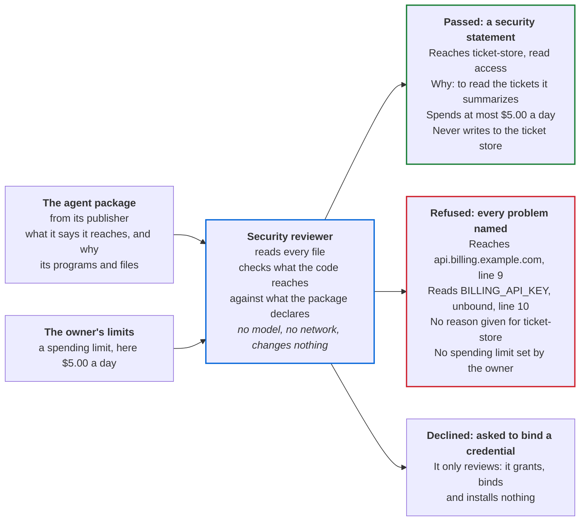

# adlc-security-reviewer

A reference implementation of the ADLC **security reviewer** role
([agentroles.ai/security-reviewer](https://agentroles.ai/security-reviewer.html), ROLES.md §34),
the Security review stage at [agenticdevelopment.ai](https://agenticdevelopment.ai/stages.html#security).

Status: spec 0.2.0; Code stage in ten rounds ([docs/rounds.md](docs/rounds.md)). The suite, the conformance cases and the removal check pass. `npm run verify` exits 0 once the spec owner re-locks: `LOCK.json` and the `handoff` tag.

## What it does for users

The security reviewer is the gate an AI agent passes before anyone installs it. It reads the
agent's package and the owner's spending limit, checks what the code actually reaches against
what the package declares, and gives one of three answers.



The answers above are from a real run on the suite's sample agent, `ticket-reader`, which
summarizes support tickets.

| Who | What they get | Why it matters |
|---|---|---|
| The owner installing an agent | A statement of every system the agent reaches, with its access and reason, what it may spend, what it must never do, and the risks accepted knowingly | They approve on facts checked against the code, not on the publisher's description |
| The agent's publisher | A refusal naming every problem at once, each with its file and line | One round of fixes clears the gate |
| The platform or security team | The same answer for the same package every time, tied to the package's digest. The reviewer never grants anything itself | Every install decision has a record, and changing one byte of the package changes its digest |

One judgment stays with a person: whether each reason is good enough. The statement shows every
reason and says so under `not_checked`.

## How this repository is built

| Path | Stage | Who changes it |
|---|---|---|
| `docs/spec.md`, `docs/traceability.md` | Requirements, Design | spec owner |
| `agents/security-reviewer/test/`, `conformance/` | Test | spec owner |
| `agents/security-reviewer/scripts/` | Code | code writer |
| `docs/rounds.md` | Code | code writer |

```bash
npm run verify   # suite, conformance cases, removal check
```

Node 22.13 or later. No dependencies.
